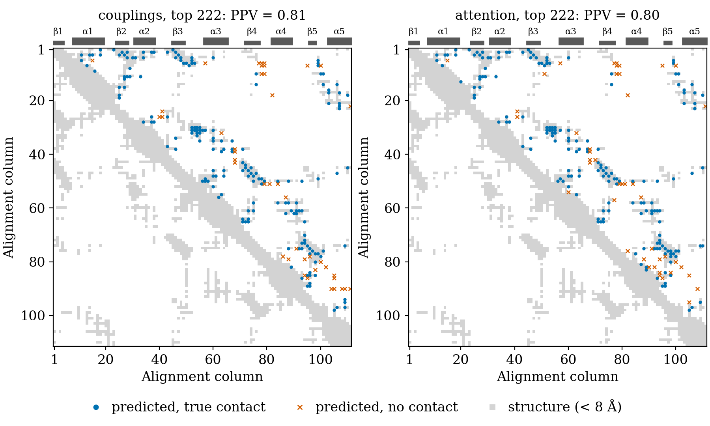
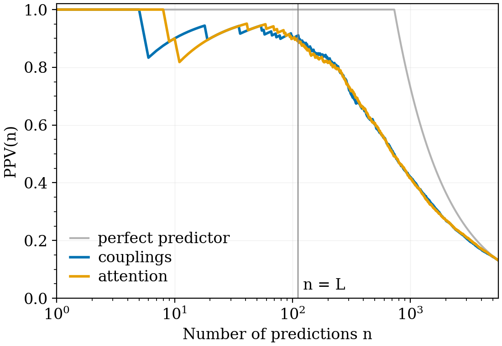
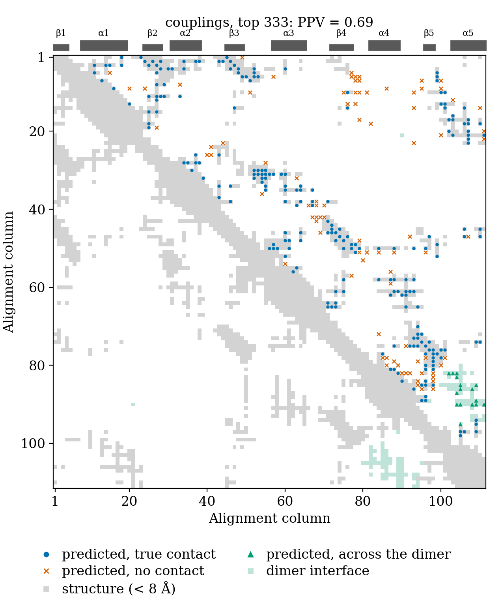
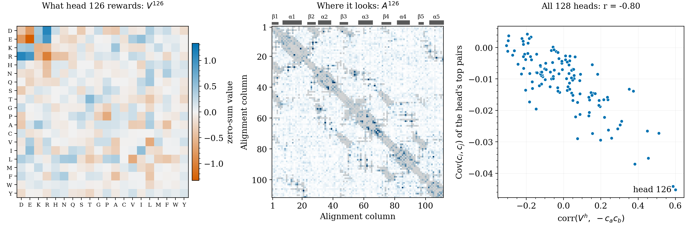

# AttentionDCA in PyTorch

A small personal project that grew out of my master's thesis at EPFL: predicting which residues of a
protein touch in 3D from sequences alone, with a Potts model whose couplings are built by a single
attention layer.

The method is not mine. It was published by [Caredda & Pagnani (2025)](https://doi.org/10.1186/s12859-025-06062-y),
who also provide a [Julia package](https://github.com/pagnani/AttentionDCA.jl). In my thesis I used a Python
port from my host lab as the basis for downstream analyses of protein families. This repository is a
standalone rewrite from the equations, simply to get acquainted with the matter: four small modules and one script, trained 
on the response regulator alignment from my thesis, on a laptop CPU, in about half an hour.



*The 222 strongest predicted residue pairs (upper triangle) on the crystal structure of* E. coli *CheY.
The model only saw sequences. Left: the classical DCA score on the couplings. Right: the attention matrices read directly.*

## Results

| Contact score | PPV@L/2 | PPV@L | PPV@2L | PPV@3L |
|---|---:|---:|---:|---:|
| Couplings (Frobenius norm + APC) | 0.93 | 0.91 | 0.81 | 0.71 |
| Attention matrices (averaged + APC) | 0.95 | 0.90 | 0.80 | 0.71 |

PPV@n is the fraction of the n strongest pairs with |i − j| ≥ 6 that are closer than 8 Å in CheY (PDB 3CHY), with
L = 111. Values are the mean of 3 seeds, with a standard deviation of at most 0.02. A random pair is in contact 13% of the
time, and 98% of the top L predictions lie within 12 Å.



The [training curve](results/RR_50000_H128_d17_s0/training.png) and the
[attention maps](results/RR_50000_H128_d17_s0/attention_maps.png) are in the results folder too.

### Many of the far-off "errors" are contacts across a dimer

Among the top 3L predictions, about 30 pairs are at least 12 Å apart within CheY. A large part of them pile up between
helices α4 and α5, which is the interface where the OmpR/PhoB subfamily, about a third of this alignment,
forms its active homodimer. Against the activated PhoB dimer (PDB 1ZES, chains B and C), 12 to 13 of these pairs
are in contact across the interface, about 40% against 1.4% for far pairs in general. The model cannot tell contacts within
a chain from contacts between two copies of it, which is a known effect in DCA (Uguzzoni et al., 2017).
The table above still counts them as errors.



### Single heads can be read

The factorisation separates *what* a head rewards (V, on amino acids) from *where* it looks (A, on sites), so a head can
be inspected on its own. Some heads have learned electrostatics without being told about charge: V rewards opposite charges and
penalises equal ones, and attention goes to consensus pairs like E39–R67, R15–E27 and R11–E27 (alignment columns).
Over all 128 heads, the more a V resembles this pattern, the more opposite charges covary at the
positions the head attends to, with r between −0.71 and −0.80 across the three seeds.



## The model

The attention of head h and the couplings are

$$A^h_{ij} = \mathrm{softmax}_j\Big(\sum_d Q^h_{di} K^h_{dj}\Big), \qquad J_{ij}(a,b) = \sum_{h=1}^{H} A^h_{ij}\, V^h(a,b) \quad (i \neq j).$$

With H = 128 and d = 17 this takes 539,520 parameters, against 2,692,305 couplings of a full Potts model on this family.
Training minimises the regularised negative pseudo-likelihood, with sequence weights $w_m$ that counter phylogenetic oversampling,

$$\mathcal{L} = -\frac{1}{\sum_m w_m} \sum_m w_m \sum_i \log P(x^m_i \mid x^m_{\setminus i}) + \lambda \sum_{i,j,a,b} J_{ij}(a,b)^2, \qquad P(x_i = a \mid x_{\setminus i}) \propto \exp \sum_{j \neq i} J_{ij}(a, x_j).$$

Contacts are ranked by the average-product-corrected Frobenius norm of the symmetrised couplings in zero-sum gauge,
or by the average-product-corrected mean of the symmetrised attention matrices.

## Repository

```
attention_dca/
    msa.py          FASTA reading, filtering, sequence weights
    model.py        the model, its objective, the training loop, I/O
    structure.py    PDB parsing, mapping a chain onto the alignment columns
    contacts.py     contact scores, evaluation, the look inside single heads, figures
run.py              load or train, evaluate, draw every figure
walkthrough.ipynb   the pipeline step by step, from the alignment to the contact map, with sanity checks
data/               the alignment with its cached weights, two PDB structures
results/            parameters, training history and metrics of the 3 seeds, figures of seed 0
```

## Running it

```bash
pip install -e .
python run.py               # loads the trained model, recomputes the metrics and redraws the figures
python run.py --seed 3      # trains a new model first, about 15 to 30 minutes on 4 CPU cores
```

Everything expensive is cached, the sequence weights next to the FASTA file and the model in `results/`. A CUDA GPU is used
automatically when available. Other families work the same way, and a structure is the only other input needed:

```bash
python run.py --fasta my_family.fasta --pdb my_structure.pdb --chain B --dimer "" --H 128 --d 5
```

From Python:

```python
from attention_dca import MSA, AttentionDCA, frobenius_score, distance_map, rank_contacts, ppv_curve

msa   = MSA("data/RR_50000.fasta.gz")
model = AttentionDCA(L=msa.L, H=128, d=17).fit(msa)
ppv   = ppv_curve(rank_contacts(frobenius_score(model)), distance_map("data/3chy.pdb", msa))
```

## Data

- `RR_50000.fasta.gz`: 50,000 sequences of the response regulator receiver domain (Pfam PF00072), L = 111 columns,
  M_eff ≈ 12,800 after reweighting. It is a sample of the roughly 855,000 sequence alignment from my thesis, which
  follows the curation of Rosset, Weigt & Zamponi (2025).
- `3chy.pdb`: *E. coli* CheY, the textbook response regulator (Volz & Matsumura, 1991). A PDB chain is mapped onto the columns by
  aligning its sequence to the family profile, which only needs Biopython.
- `1zes.pdb`: the BeF₃⁻-activated PhoB receiver domain (Bachhawat et al., 2005).

## Checks

- **Against the paper.** On the authors' PF00014 data, reading and reweighting give their M = 8871 and M_eff ≈ 2950, and
  training reproduces their contact prediction:

  | PF00014, authors' reference distances | PPV@L | PPV@2L | PPV@3L |
  |---|---:|---:|---:|
  | Paper, single run | 1.00 | 0.81 | 0.65 |
  | Paper, 20 runs merged | 1.00 | 0.89 | 0.75 |
  | This code, single run | 1.00 | 0.88 | 0.75 |

- **Against the code used in my thesis.** Tokens and weights are identical, and the loss and its gradients agree to within
  10⁻¹². Models trained with that code on the same alignment reach PPV@L = 0.90 and 0.91 on CheY.
- **Structure mapping.** The catalytic residues of CheY (D12, D13, D57, T87, K109) land exactly on the columns where the family
  conserves them, for example D57 on a column that is 96% aspartate.

## Choices worth knowing about

- **The couplings are computed explicitly.** Per batch this replaces a loop over heads by one matrix product against the one-hot
  sequences, about 20 times faster at H = 128. It costs L²q² memory, about 22 MB here, which is fine for
  domains but would grow quickly for very long proteins.
- **Early stopping restores the best parameters.** 20% of the alignment is held out for this, so the model trains on
  the remaining 80%. The Julia package instead trains for a fixed number of epochs.
- **The score uses the Frobenius norm**, as in Eq. 7 of the paper. The reference code uses the squared norm, which ranked a little
  worse here.

## Limitations

- A single crystal structure is a strict ground truth for a whole family: against PhoB (PDB 1B00), PPV@L is 0.82 instead of 0.91.
  The paper reports PPV@L = 1.00 on this family, but against a much denser reference with 2,290 contacts where CheY has 731,
  and with a deeper alignment, so the numbers are not directly comparable.
- These are single runs. The paper merges 20 runs for its best results, and that step is not implemented here.
- The full 855,000 sequence alignment is not used, because the O(M²) sequence weights alone would take over 5 hours on a laptop CPU.

## References

- Caredda F., Pagnani A. *Direct coupling analysis and the attention mechanism.* BMC Bioinformatics 26, 41 (2025).
- Bhattacharya N. et al. *Interpreting Potts and Transformer Protein Models Through the Lens of Simplified Attention.* PSB (2022).
- Uguzzoni G. et al. *Large-scale identification of coevolution signals across homo-oligomeric protein interfaces by direct coupling analysis.* PNAS 114, E2662 (2017).
- Rosset L., Weigt M., Zamponi F. *Data Augmentation Enables Label-Specific Generation of Homologous Protein Sequences.* bioRxiv (2025).
- Volz K., Matsumura P. *Crystal structure of Escherichia coli CheY refined at 1.7-Å resolution.* J. Biol. Chem. 266, 15511 (1991).
- Bachhawat P. et al. *Mechanism of activation for transcription factor PhoB suggested by different modes of dimerization in the inactive and active states.* Structure 13, 1353 (2005).

## License

MIT, see [LICENSE](LICENSE).
